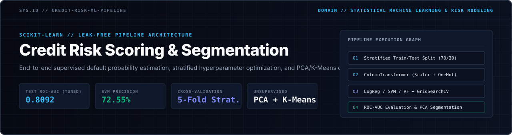
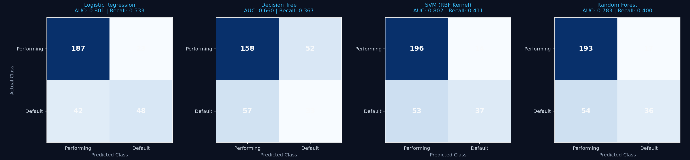
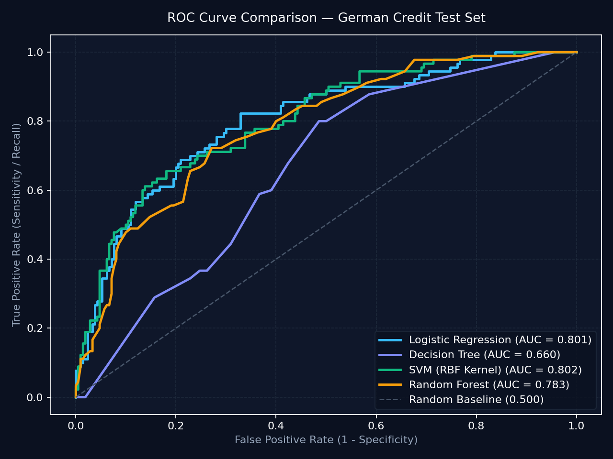
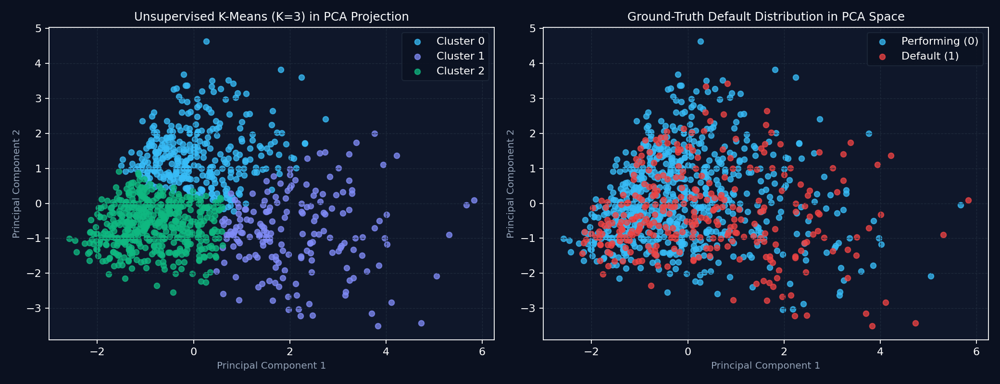

<p align="center">
  
</p>

<p align="center">
  
  
  
  
</p>

---

## Overview

This repository implements an end-to-end machine learning pipeline for **financial credit risk assessment and borrower segmentation** based on the German Credit dataset (`1,000` records, `20` socio-economic and financial attributes).

In institutional lending, false negatives (classifying a defaulting borrower as a performing borrower) carry a significantly higher financial cost than false positives. Consequently, this architecture prioritizes **zero data leakage**, **ROC-AUC discrimination**, and **default recall calibration** alongside unsupervised structural clustering via **Principal Component Analysis (PCA)** and **K-Means**.

---

## Architectural Design

### 1. Leak-Free Preprocessing (`ColumnTransformer` & `Pipeline`)
To prevent statistical leakage between training and evaluation partitions:
- The dataset is partitioned using a **70/30 stratified split** (`stratify=y`) prior to any feature transformation, preserving the exact `30.0%` default class ratio across both subsets.
- Continuous numerical features (`7` attributes) are standardized (`mean = 0`, `variance = 1`) via `StandardScaler`.
- Categorical attributes (`13` attributes) are encoded via `OneHotEncoder(handle_unknown="ignore")`, ensuring production resilience against unseen category levels at inference time.
- Every estimator is encapsulated inside a unified `sklearn.pipeline.Pipeline` so transformations are fitted strictly on training folds during cross-validation.

### 2. Supervised Model Benchmark
Four distinct model families were evaluated on the held-out test set (`N = 300`):

| Model Architecture | Accuracy | Precision (Default) | Recall (Default) | F1-Score | ROC-AUC |
| :--- | :---: | :---: | :---: | :---: | :---: |
| **Logistic Regression (Baseline)** | **0.7833** | 0.6761 | **0.5333** | **0.5963** | 0.8011 |
| **SVM (RBF Kernel)** | 0.7767 | **0.7255** | 0.4111 | 0.5248 | **0.8022** |
| **Random Forest (100 Trees)** | 0.7633 | 0.6792 | 0.4000 | 0.5035 | 0.7828 |
| **Decision Tree (`max_depth=4`)** | 0.6367 | 0.3882 | 0.3667 | 0.3771 | 0.6595 |

### 3. Regularization & Hyperparameter Optimization
Using `GridSearchCV` with a 5-fold `StratifiedKFold` scheme optimizing `roc_auc`:
- Optimal configuration: `C = 0.1`, `penalty = "l2"`, `solver = "lbfgs"`.
- Cross-Validation ROC-AUC: `0.7734`
- Held-Out Test Set ROC-AUC: **`0.8092`**

---

## Visual Diagnostics & Empirical Results

### Confusion Matrix Comparison Across Architectures
<p align="center">
  
</p>

### Receiver Operating Characteristic (ROC) Curves
<p align="center">
  
</p>

### Unsupervised Borrower Segmentation (PCA + K-Means)
Dimensionality reduction via 2-component PCA (`24.80%` explained variance across the high-dimensional one-hot feature space) paired with `K-Means (K = 3)` identifies three natural socio-economic borrower clusters without target supervision:

<p align="center">
  
</p>

---

## Repository Structure

```text
credit-risk-ml-pipeline/
├── assets/
│   └── banner.svg                      # Vector architectural specification header
├── notebooks/
│   └── credit_risk_analysis.ipynb      # Complete experimental notebook and analysis
├── results/
│   ├── confusion_matrices.png          # Test set confusion matrices across 4 models
│   ├── metrics.json                    # Serialized benchmark and GridSearchCV metrics
│   ├── pca_kmeans_clusters.png         # 2D PCA projection and K-Means segmentation
│   └── roc_curves.png                  # Comparative ROC-AUC curves
├── src/
│   └── pipeline.py                     # Reproducible training, tuning, and plotting engine
├── requirements.txt                    # Python package dependencies
└── README.md                           # System documentation
```

---

## Execution & Reproducibility

```bash
# 1. Install dependencies
pip install -r requirements.txt

# 2. Execute the full pipeline, hyperparameter grid search, and figure generation
python src/pipeline.py
```

---

## Author

**Alfredo Ramos**  
Artificial Intelligence & Computer Vision Engineer  
[GitHub](https://github.com/Alfredo-ctrl) · [LinkedIn](https://linkedin.com/in/alfredo-ramos-olivan-07751a3a5)
